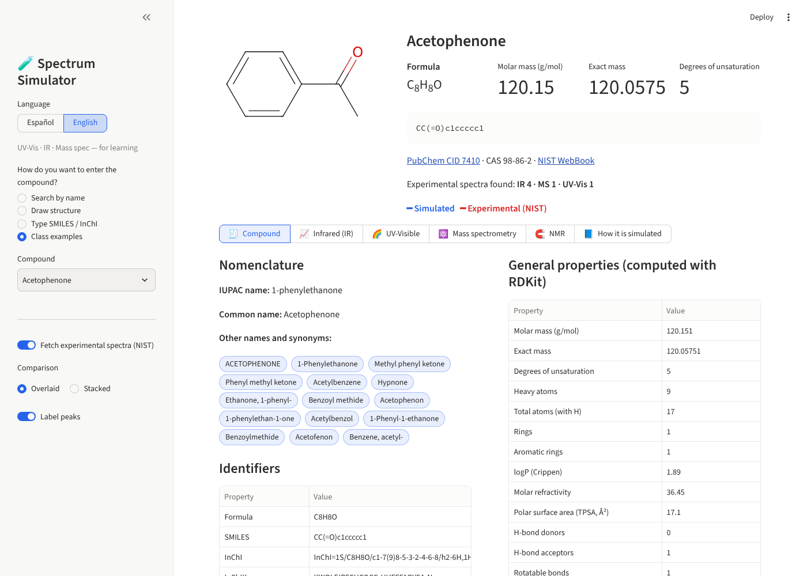
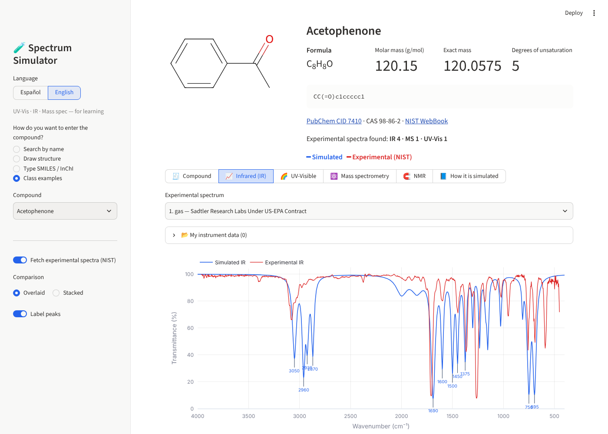
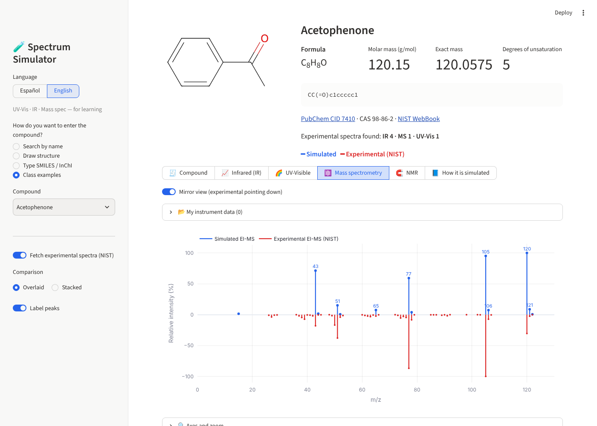
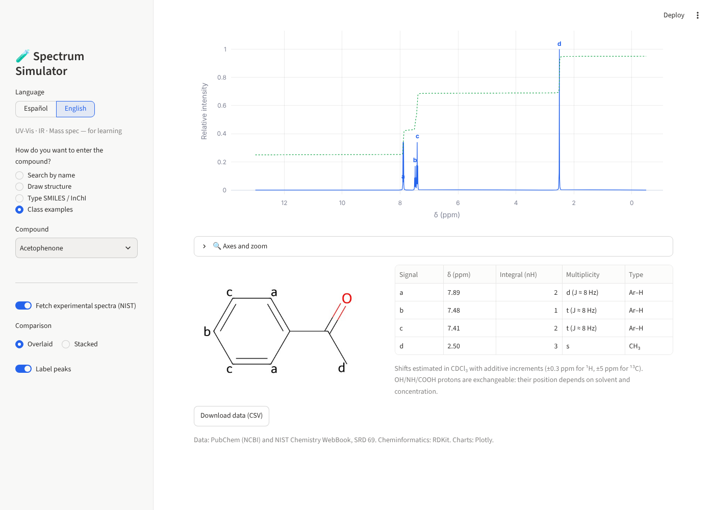
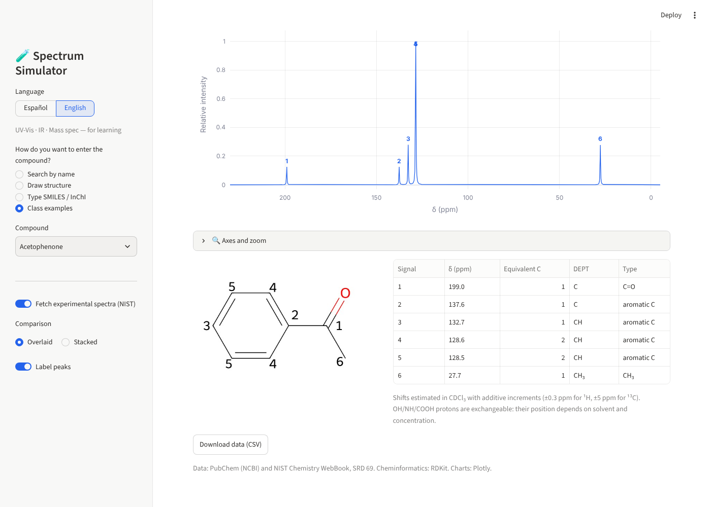

# Spectrum Simulator – For Learning

An educational simulator of **UV-Vis**, **IR**, **mass (EI-MS)** and **¹H / ¹³C NMR** spectra for any compound:
one you draw as a class exercise or one that already exists. When the compound is found in the
molecular databases, the app shows the **simulated spectrum next to the experimental one** so
students can compare them.

The interface is bilingual (**Español / English**). Switching the language or the input mode never loses
the structure, the drawing, uploaded files, axis ranges or any other setting.

| Compound and nomenclature | IR (simulated vs. NIST) | UV-Vis |
|---|---|---|
|  |  |  |

| Mass spectrum (mirror view) | ¹H NMR | ¹³C NMR |
|---|---|---|
|  |  |  |

## Features

- **Compound input:** draw it in the Ketcher editor, search by name, CAS number or InChIKey (PubChem),
  type a SMILES / InChI / Molfile, or pick one of the built-in class examples.
  The structure on screen is kept when you switch between these modes, so you can look a compound
  up by name and then edit it in the drawing editor.
- **Compound sheet:** IUPAC name, common name and synonyms (PubChem), identifiers (formula, SMILES, InChI,
  InChIKey, CID, CAS), functional groups, general properties (molar and exact mass, degrees of unsaturation,
  rings, logP, molar refractivity, TPSA, H-bond donors/acceptors, rotatable bonds, sp³ fraction, stereocentres,
  formal charge, Lipinski rule) and elemental composition. New structures that are not in PubChem show their
  identifiers so students can work out the IUPAC name themselves.
- **IR:** detected functional groups, assigned bands (C=O, O–H, N–H, C≡N, NO₂ stretches…), spectrum in % transmittance.
- **UV-Vis:** conjugated systems, π→π* and n→π* transitions, λmax, log ε and an estimate of the apparent colour.
- **Mass spectrum:** molecular ion with its exact isotope pattern (M+1, M+2 for Cl/Br/S) and fragments with an
  interpretation (α-cleavage, acylium, iminium, tropylium m/z 91, McLafferty rearrangement, neutral losses),
  plus the nitrogen rule.
- **¹H and ¹³C NMR:** equivalent atoms grouped by symmetry, chemical shifts from additive increments, integrals,
  n+1 multiplicities with J, an integration curve, DEPT-style carbon types, selectable spectrometer field
  (60–800 MHz), and signal letters drawn on the structure.
- **Experimental data:** the compound is identified in **PubChem** by its InChIKey, its CAS number is retrieved,
  and its IR, MS and UV-Vis spectra are downloaded from the **NIST Chemistry WebBook** (JCAMP-DX).
  Spectra can be overlaid or stacked; the mass spectrum also has a mirror view.
- **Your own instrument data:** upload the files exported by the spectrophotometer, FTIR, mass spectrometer or
  NMR (`.csv`, `.txt`, `.tsv`, `.asc`, `.dat`, JCAMP-DX `.dx/.jdx`) and plot them next to the simulation.
  Comma, semicolon, tab or space separators, decimal comma and header lines are detected automatically;
  several files and several Y columns can be shown at once. For UV-Vis, enter the concentration to convert
  absorbance to ε (Beer-Lambert), or leave it at 0 to compare band shapes. An example export is in
  [`examples/uv_acetophenone_example.csv`](examples/uv_acetophenone_example.csv).
- **Interactive charts:** zoom with the mouse wheel or a box, pan, double-click to reset, set exact axis ranges,
  and save any chart as PNG.
- Every simulated spectrum can be exported as CSV.

## Installation

Requires Python 3.10 or newer.

```bash
pip install -r requirements.txt
```

```bash
streamlit run app.py
```

The app opens in your browser at `http://localhost:8501`.

### Publishing it for a class (free)

1. Sign in to [share.streamlit.io](https://share.streamlit.io) with your GitHub account.
2. *Create app* → repository `Eleos-pax/Spectrum-Simulator---For-Learning`, branch `main`, file `app.py`.
3. Share the link with your students.

## Project layout

```
app.py                 User interface (Streamlit + Plotly + Ketcher), state kept across language/mode changes
spectra/simulate.py    IR / UV-Vis / EI-MS simulation engine (RDKit)
spectra/databases.py   PubChem and NIST WebBook clients, JCAMP-DX reader
spectra/nmr.py         ¹H / ¹³C NMR prediction (additive increments)
spectra/i18n.py        Spanish / English interface text and label translation
examples/              Example instrument export for testing the upload
```

## How the spectra are simulated (and their limits)

The models are **empirical** and meant for learning to interpret spectra:

- **IR:** group-frequency table matched with SMARTS patterns, C–H stretches by hybridisation, a C=O shift
  for conjugation, and Lorentzian band shapes. The fingerprint region (< 1500 cm⁻¹) is only illustrative.
- **UV-Vis:** size of the conjugated system, fused aromatic rings and auxochromes, in the spirit of the
  Woodward-Fieser rules; Gaussian bands on an energy scale.
- **MS:** ion and radical stability rules (Stevenson's rule); no fragmentation kinetics.
- **NMR:** Shoolery-type increments for aliphatic ¹H, benzene + ortho/meta/para increments for aromatic ¹H,
  Grant-Paul rules for aliphatic ¹³C, ipso/ortho/meta/para increments for aromatic ¹³C; first-order multiplets.
  Typical accuracy is about ±0.3 ppm (¹H) and ±5 ppm (¹³C). NIST does not publish NMR spectra, so
  experimental NMR comparison uses files you upload.

For research work, use measured spectra or quantum-chemical calculations (DFT / TD-DFT).

## Data sources and credits

- PubChem PUG REST (NCBI/NIH).
- NIST Chemistry WebBook, NIST Standard Reference Database 69. Experimental spectra belong to their
  authors and to NIST; please cite them when you use them.
- RDKit (cheminformatics), Plotly (charts), Ketcher (structure editor), Streamlit (web app).
