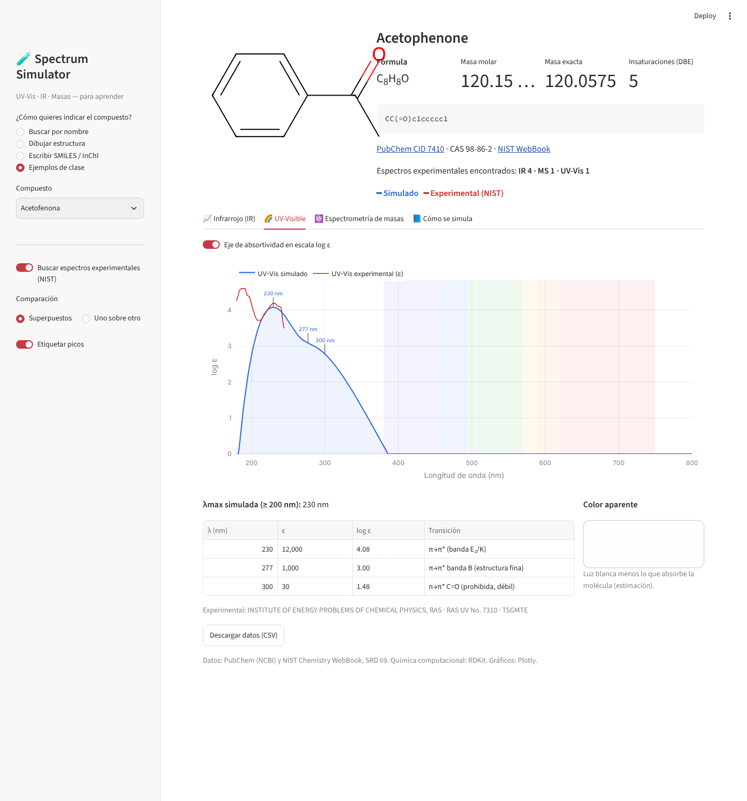

# Spectrum Simulator – For Learning

Simulador didáctico de espectros **UV-Vis**, **IR** y **masas (EI-MS)** para cualquier compuesto:
uno que dibujes como ejercicio de clase o uno que ya exista. Si el compuesto está en las bases de
datos, la app muestra el espectro **simulado junto al experimental** para compararlos.

| IR (simulado vs. NIST) | UV-Vis | Masas (vista espejo) |
|---|---|---|
|  |  |  |

## Qué hace

- **Entrada del compuesto:** dibujarlo en el editor Ketcher, buscarlo por nombre (PubChem),
  escribir SMILES / InChI / Molfile, o elegir uno de los ejemplos de clase.
- **Datos generales:** fórmula, masa molar, masa exacta, insaturaciones (DBE), SMILES canónico.
- **IR:** grupos funcionales detectados, bandas asignadas (ν C=O, O–H, N–H, C≡N, NO₂…), espectro en %T.
- **UV-Vis:** sistemas conjugados, transiciones π→π* y n→π*, λmax, log ε y color aparente.
- **Masas:** ion molecular con patrón isotópico exacto (M+1, M+2 de Cl/Br/S), fragmentos con su
  interpretación (ruptura α, acilio, iminio, tropilio m/z 91, McLafferty, pérdidas neutras).
- **Experimental:** el compuesto se identifica en **PubChem** por su InChIKey, se obtiene su nº CAS y se
  descargan sus espectros IR, MS y UV-Vis del **NIST Chemistry WebBook** (JCAMP-DX).
  Se pueden ver superpuestos o uno sobre otro.
- Exportación de cada espectro simulado a CSV.

## Instalación y uso

Requiere Python 3.10 o superior.

```bash
pip install -r requirements.txt
```

```bash
streamlit run app.py
```

Se abre en el navegador en `http://localhost:8501`.

### Publicarlo para la clase (gratis)

1. Entra en [share.streamlit.io](https://share.streamlit.io) con tu cuenta de GitHub.
2. *Create app* → repositorio `Eleos-pax/Spectrum-Simulator---For-Learning`, rama `main`, archivo `app.py`.
3. Comparte el enlace con tus estudiantes.

## Estructura

```
app.py                 Interfaz (Streamlit + Plotly + Ketcher)
spectra/simulate.py    Motor de simulación IR / UV-Vis / EI-MS (RDKit)
spectra/databases.py   PubChem, NIST WebBook y lector JCAMP-DX
```

## Cómo se simula (y sus límites)

Los modelos son **empíricos**, pensados para enseñar a interpretar espectros:

- **IR:** tabla de frecuencias de grupo con patrones SMARTS, bandas C–H según hibridación, corrección por
  conjugación del C=O y bandas lorentzianas. La región de huella (< 1500 cm⁻¹) es ilustrativa.
- **UV-Vis:** tamaño del sistema conjugado, anillos aromáticos fusionados y auxocromos, al estilo de las
  reglas de Woodward-Fieser; bandas gaussianas en energía.
- **MS:** reglas de estabilidad de iones y radicales (Stevenson), sin cinética de fragmentación.

Para investigación usa espectros medidos o cálculos de química cuántica (DFT / TD-DFT).

## Fuentes de datos

- PubChem PUG REST (NCBI/NIH).
- NIST Chemistry WebBook, NIST Standard Reference Database 69. Los espectros experimentales
  pertenecen a sus autores y al NIST; cítalos si los usas en trabajos.
- RDKit (química computacional), Plotly (gráficos), Ketcher (editor de estructuras).
